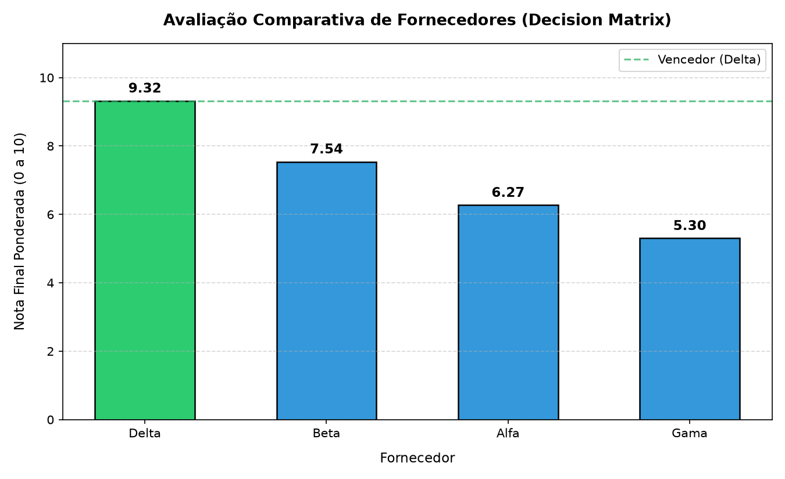

# Relatório de Seleção de Fornecedores (Decision Matrix)

## 1. Contexto e Objetivo
Avaliação comparativa de 4 fornecedores com base em critérios técnicos, operacionais e financeiros, utilizando a metodologia estruturada de **Matriz de Decisão**.

## 2. Critérios e Pesos Definidos
- **Preço Unitário (30%):** Menor custo por unidade (menor é melhor).
- **Taxa de Defeitos (30%):** Percentual de falhas no lote (menor é melhor).
- **Prazo de Entrega (20%):** Tempo em dias para entrega (menor é melhor).
- **Nota de Suporte (20%):** Avaliação do atendimento ao cliente (maior é melhor).

## 3. Matriz de Avaliação e Pontuações

| Posição | Fornecedor | Preço (30%) | Prazo (20%) | Defeitos (30%) | Suporte (20%) | **Nota Final** |
| :---: | :--- | :---: | :---: | :---: | :---: | :---: |
| **1º** | **Delta** | 7.73 (2.32) | 10.0 (2.0) | 10.0 (3.0) | 10.0 (2.0) | **9.32** |
| **2º** | **Beta** | 8.5 (2.55) | 8.0 (1.6) | 5.0 (1.5) | 9.47 (1.89) | **7.54** |
| **3º** | **Alfa** | 9.44 (2.83) | 5.0 (1.0) | 2.5 (0.75) | 8.42 (1.68) | **6.27** |
| **4º** | **Gama** | 10.0 (3.0) | 3.33 (0.67) | 1.25 (0.38) | 6.32 (1.26) | **5.3** |

*(Obs: Formato `Nota (Ponderada)`. Escala de notas de 1 a 10).*

## 4. Recomendação Final

### Vencedor: **Fornecedor Delta** (Nota: **9.32/10**)

**Principais Vantagens:**
- Menor taxa de defeitos (0.5%), garantindo alta qualidade.
- Menor prazo de entrega (4.0 dias).
- Melhor avaliação de suporte (9.5/10).

**Trade-off (Ponto de atenção):**
- Possui o maior preço unitário (R$ 110.00), mas a sua qualidade e velocidade superam essa desvantagem nos critérios ponderados.

